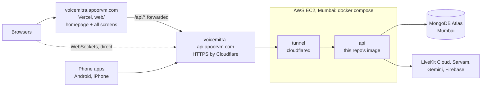

# Deploying VoiceMitra to the cloud

How the pieces fit once deployed:



- **Backend:** one Docker container on one small server. One instance on purpose: live calls and the
  dose/reminder timers are kept in memory (see `PLAN.md`).
- **No open web ports.** The Cloudflare tunnel connects *out* from the server, so the server only needs
  SSH open, and Cloudflare provides the HTTPS certificate.
- **CI/CD:** `.github/workflows/backend.yml`. Pull request: tests. Push to `main` (backend files): tests →
  image on `ghcr.io/apoorv012/voicemitra-api` → deploy over SSH → wait for `/health/ready` → roll back to
  the previous image if it doesn't come up. The deploy job is skipped until `DEPLOY_HOST` is set.
- **Web:** Vercel builds `web/` itself on every push that changes it (`web/vercel.json`).

Two hostnames (decided):

| Host | What | Who uses it |
|---|---|---|
| `voicemitra.apoorvm.com` | The website on Vercel: homepage, log in, and every screen (patient, caregiver, doctor, operator) | Browsers |
| `voicemitra-api.apoorvm.com` | The API only (FastAPI). **Not created yet** (steps 2-5) | The website, and the phone apps |

The phone apps only ever talk to the API host, never to the website. Both hosts stay **one level under
`apoorvm.com`** (not `api.voicemitra.apoorvm.com`): Cloudflare's free certificate only covers one level.

---

## 1. MongoDB Atlas (you, any time)

1. <https://cloud.mongodb.com> → create a project `VoiceMitra` → **Create cluster** → **M0 (free)**,
   provider **AWS**, region **Mumbai (ap-south-1)**.
2. **Database Access** → add user `voicemitra`, a generated password, role *Read and write to any database*.
3. **Network Access** → add the server's Elastic IP (step 3) when you have it. Don't use `0.0.0.0/0`.
4. **Connect → Drivers** → copy the `mongodb+srv://...` string. It goes in the server's `.env` as `MONGODB_URI`.

Moving today's data over is optional: you can start fresh and seed instead. To copy it (needs
[MongoDB Database Tools](https://www.mongodb.com/try/download/database-tools)):

```bash
mongodump --db voicemitra --out dump
```
```bash
mongorestore --uri "<the mongodb+srv string>" --nsInclude "voicemitra.*" dump
```

## 2. Cloudflare tunnel (you, any time)

1. Cloudflare dashboard → **Zero Trust → Networks → Tunnels → Create a tunnel** → *Cloudflared* → name it
   `voicemitra-cloud`. Copy the **token** from the install command (the long string after `--token`).
   Skip the install step: the server runs cloudflared in Docker.
2. **Public hostname**: `voicemitra-api` . `apoorvm.com`, service **HTTP** → `api:8000`.

The existing `test-voicemitra` tunnel to your PC stays as it is, for development.

## 3. AWS server (your friend's account)

Ask your friend to create an **IAM user** for you with EC2 access, rather than sharing the root login,
and to set a **budget alert** (Billing → Budgets, e.g. $1) so nothing costs money by surprise.

1. EC2 → region **Asia Pacific (Mumbai) ap-south-1** → **Launch instance**:
   - **Ubuntu Server 24.04 LTS**, 64-bit (x86).
   - Type: whatever the wizard marks **Free tier eligible**. `t3.small` (2 GB) is comfortable;
     `t3.micro` (1 GB) works with the swap the setup script adds. If you choose an ARM type (`t4g`), set
     `IMAGE_PLATFORMS=linux/arm64` in step 5.
   - Key pair: create one (`voicemitra-admin`) and keep the `.pem` safe. That's your own login.
   - Network: a new security group with **SSH (22) only**, from anywhere (GitHub's runners have changing
     IPs; logins are key-only). No HTTP/HTTPS rules needed.
   - Storage: 20 GB gp3.
2. **Elastic IPs → Allocate → Associate** with the instance, so the address never changes (Atlas and
   GitHub both use it).
3. Log in and run the setup script once:

```bash
ssh -i voicemitra-admin.pem ubuntu@<elastic ip>
```
```bash
curl -fsSL https://raw.githubusercontent.com/Apoorv012/VoiceMitra/main/deploy/bootstrap-server.sh | sudo bash
```

4. Give GitHub its own key (so the admin key never leaves your machine). On your PC:

```bash
ssh-keygen -t ed25519 -f voicemitra-deploy -N "" -C "github-actions deploy"
```

   and add `voicemitra-deploy.pub` to the server's `~/.ssh/authorized_keys` (one line, appended).

## 4. Secrets on the server

From your PC (Git Bash), after filling in a copy of `deploy/server.env.example` (Atlas string from step 1,
tunnel token from step 2, the other keys from your local `.env`):

```bash
scp -i voicemitra-admin.pem server.env ubuntu@<elastic ip>:/opt/voicemitra/.env
```
```bash
scp -i voicemitra-admin.pem C:/Users/apoor/keys/voicemitra/<firebase key>.json ubuntu@<elastic ip>:/opt/voicemitra/secrets/firebase.json
```
```bash
ssh -i voicemitra-admin.pem ubuntu@<elastic ip> "chmod 600 /opt/voicemitra/.env /opt/voicemitra/secrets/firebase.json"
```

Delete the local `server.env` copy afterwards. The repo is public, so never commit it.

## 5. GitHub settings

Set these as **repository** variables and secrets (Settings → Secrets and variables → Actions), not
environment ones: the deploy job checks `DEPLOY_HOST` before it starts.

```bash
gh variable set DEPLOY_HOST --body "<elastic ip>"
```
```bash
gh variable set DEPLOY_USER --body "ubuntu"
```
```bash
gh secret set DEPLOY_SSH_KEY < voicemitra-deploy
```
```bash
ssh-keyscan <elastic ip> 2>/dev/null | gh variable set DEPLOY_KNOWN_HOSTS
```

The last one pins the server's identity so a deploy can't be redirected to another machine. Run it once,
right after creating the server. Only for an ARM server: `gh variable set IMAGE_PLATFORMS --body "linux/arm64"`.

Then **Actions → Backend → Run workflow** (or push a backend change to `main`). Check it:

```bash
curl https://voicemitra-api.apoorvm.com/health/ready
```

It should say `{"status":"ok","version":"<commit>"}`.

## 6. Website on Vercel at voicemitra.apoorvm.com (you, any time; API calls work once step 5 is done)

1. <https://vercel.com> → sign in with GitHub → **Add New → Project** → import `Apoorv012/VoiceMitra`.
2. **Root Directory: `web`** (framework is detected as Next.js).
3. Environment variables (Production and Preview):
   - `BACKEND_URL` = `https://voicemitra-api.apoorvm.com`
   - `NEXT_PUBLIC_WS_ORIGIN` = `wss://voicemitra-api.apoorvm.com`

   The build fails on purpose if either is missing (`web/next.config.ts`). Set them now even though the API
   host doesn't exist yet.
4. Deploy.
5. Domain: Vercel project → **Settings → Domains → Add** `voicemitra.apoorvm.com`. Vercel shows the DNS record it
   wants; add it in Cloudflare DNS (usually `CNAME voicemitra → cname.vercel-dns.com`, or the project-specific value
   Vercel shows) with the proxy **off** (grey cloud), so Vercel can issue the certificate.

Until the API is live (steps 2-5 above) the site already works as a website: the homepage loads, but log in, the screens and the
contact form can't reach the API (the form then shows the email address instead).

Vercel redeploys on every push that changes `web/`, and builds a preview for pull requests.

## 7. Phone apps (point them at the API host, never the website)

In `mobile/android/gradle.properties` uncomment `voicemitra.serverUrl=https://voicemitra-api.apoorvm.com`,
then build and send the APK (`mobile/android/README.md`). Phones that already have the app pick up the new
address with the update, unless someone typed an address under Me → Advanced. Build updates on the same PC
each time: a sideloaded update has to be signed with the same key as the installed app.

iPhone: Settings (gear) → server address `https://voicemitra-api.apoorvm.com`, or change `defaultServer` in
`mobile/ios/VoiceMitra/Sources/VoiceMitra/Store.swift` (today the home tunnel) before building.

---

## Day to day

- **Deploy:** push to `main`. Backend changes go to the server; `web/` changes go to Vercel.
- **A deploy restarts the API, which drops any call in progress.** Reminders and dose timers come back
  from the database. Avoid pushing backend changes while someone is on a call.
- **Logs:** `ssh -i voicemitra-admin.pem ubuntu@<ip> "cd /opt/voicemitra && docker compose logs -f --tail 100 api"`
- **Roll back:** re-run an older successful *Backend* run in the Actions tab (it redeploys that commit), or on
  the server: `cd /opt/voicemitra && IMAGE_TAG=<older sha> docker compose up -d`.
- **Change a setting:** edit `/opt/voicemitra/.env` on the server, then `docker compose up -d` there.
- **Dependencies:** the image installs `requirements.lock`, not `requirements.txt`. After changing
  `requirements.txt`, regenerate the lock (command at the top of `requirements.lock`).
